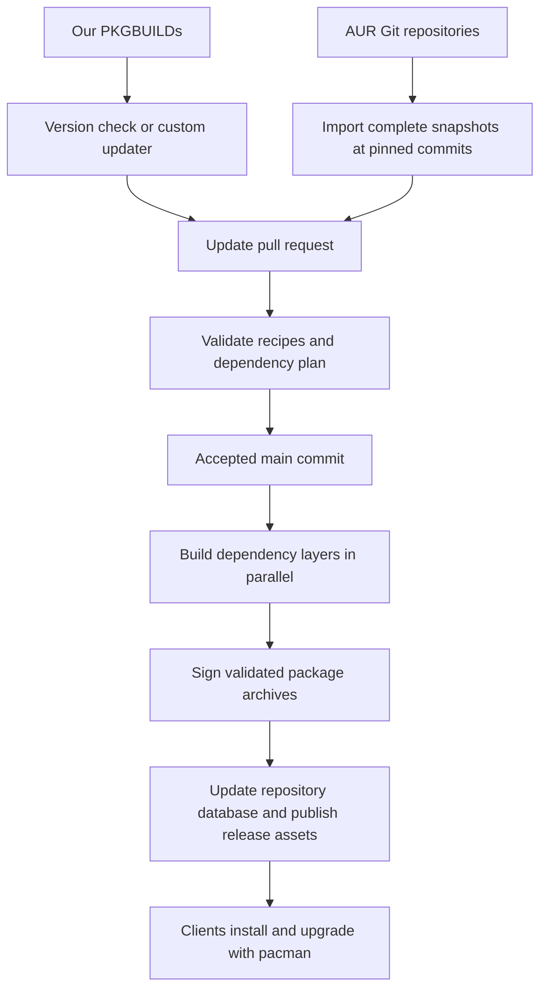

# Design: an Arch Linux package repository on GitHub

Proposal dated 30 October 2026.

Build both our maintained PKGBUILDs and selected AUR recipes with GitHub Actions, then serve the signed binary packages from GitHub Releases. Start with a public repository, the `x86_64` architecture, and architecture-independent packages. The proposed GitHub repository is `liblaf/arch-repo`; that name is illustrative until the repository is created.

Both sources produce the same pacman repository. Their ownership and update rules differ:

| Source | Recipe authority | How an update is prepared | Our responsibility |
| --- | --- | --- | --- |
| Maintained | Recipe files in our Git repository | An upstream version check or a package-specific updater edits the recipe | Maintain the recipe, patches, version scheme, and package checks |
| AUR | A particular commit of the upstream AUR Git repository | The bot imports the complete recipe snapshot and advances its recorded commit | Select the recipe, validate it, build it, and maintain our binary distribution |

An AUR entry supplies build files and source locations. Our runners build the binary packages; users download those packages through pacman. Imports retain their upstream attribution and license information. A local functional patch changes the entry into a maintained fork, with its AUR origin recorded.



**The Git repository contains a catalog and the recipe snapshots.** Use one directory per `pkgbase`, including all auxiliary files belonging to that recipe. A split PKGBUILD remains one build unit and can produce several package names. [SRCINFO specification](https://man.archlinux.org/man/SRCINFO.5.en)

```text
arch-repo/
├── catalog.toml
├── sources.lock.json
├── mihomo-smart-bin/             # source = maintained
│   ├── PKGBUILD
│   ├── .SRCINFO
│   ├── mihomo-smart-bin.install
│   ├── LICENSE
│   └── update.py
├── example-aur/                  # source = aur; illustrative name
│   ├── PKGBUILD
│   ├── .SRCINFO
│   └── ...                      # all tracked upstream recipe files
├── ci/
│   ├── update.py
│   ├── plan.py
│   ├── build.sh
│   └── publish.py
└── .github/workflows/
    ├── updates.yml
    ├── validate.yml
    ├── release.yml
    └── aur-publish.yml           # optional export of our recipes
```

The following TOML is a proposed configuration contract for our scripts:

```toml
[repository]
name = "liblaf"
architecture = "x86_64"
release_tag = "repo-x86_64"

[packages.mihomo-smart-bin]
source = "maintained"
updater = "custom"
publish_aur = true

[packages.example-aur]
source = "aur"
pkgbase = "example-aur"
publish_aur = false
```

Catalog entries select root packages. The generated lock also records the admitted dependency closure: source kind, AUR URL and full commit where applicable, recipe tree hash, upstream version, selected outputs, and resolved source commits or digests. New dependencies appear in the update PR alongside the recipes that require them. Provider overrides belong in the catalog when more than one package can satisfy a dependency.

The imported AUR directories are complete, verbatim snapshots. Keeping their contents in Git makes the changes visible in PRs and preserves accepted recipes if the upstream repository later changes or becomes unavailable. An import records both the AUR commit and the resulting tree hash. [AUR fetching with aurutils](https://github.com/aurutils/aurutils/blob/master/man1/aur-fetch.1)

**Our recipes and AUR imports have separate update mechanisms.** A scheduled workflow runs every six hours and can also be dispatched manually.

For our ordinary release packages, store `.nvchecker.toml` beside the PKGBUILD and use `pkgctl version upgrade`. It updates `pkgver`, resets `pkgrel` to `1`, and refreshes checksums. Package-specific adapters handle additional source versions, unusual naming, and mutable release assets. The existing Mihomo updater remains such an adapter: it checks the core asset, model digest, and Git revision count. A fixed release tag alone does not identify those changing inputs. [pkgctl version configuration](https://man.archlinux.org/man/pkgctl-version.1.en), [upgrade behavior](https://man.archlinux.org/man/extra/devtools/pkgctl-version-upgrade.1.en)

For imported AUR packages, the bot compares upstream Git commits, then imports the selected new commit. Comparing commits detects recipe, patch, and dependency changes even when `pkgver` and `pkgrel` remain unchanged. An upstream history rewrite is highlighted for review before advancing the accepted pin. AUR RPC metadata helps discover package names and their package bases; the accepted recipe snapshot determines what is built. The normal version-driven `aur sync --upgrades` path is therefore a useful helper, rather than the authority for our accepted recipe revisions. [aur-sync behavior](https://github.com/aurutils/aurutils/blob/master/man1/aur-sync.1)

The bot opens or refreshes an update PR containing recipe changes, source locks, generated metadata, and a summary of dependency/provider changes. Independent updates use separate PRs; an update and its required dependency changes share a PR. PR validation builds and exercises the proposed recipes. Routine updates can auto-merge after the required checks pass; newly admitted recipes and changes to build logic or provider selection receive explicit review.

Use a GitHub App token for creating and updating these PRs when CI must start automatically. Current GitHub behavior places PR workflows triggered by the default `GITHUB_TOKEN` in an approval-required state. [GitHub token behavior](https://docs.github.com/en/actions/concepts/security/github_token)

**The build plan resolves dependencies against the accepted recipe snapshots.** Resolve an explicitly configured provider first, then a satisfying official Arch package, then a satisfying package in our catalog. Discover an additional AUR dependency when those choices cannot satisfy the requirement, and propose its admission in the lock and recipe tree. Ambiguous providers, version conflicts, and dependency cycles stop the affected plan with a concrete explanation.

Keep `pkgbase` and `pkgname` distinct throughout planning. Include runtime, build, and enabled test dependencies, architecture-specific metadata, and the effective dependencies of every published split output. Optional dependencies are selected explicitly through the catalog. Use pacman/version comparisons for constraints and verify the resulting package metadata during the build.

aurutils supplies useful discovery and graph helpers. `aur depends` can find an AUR dependency closure, while `aur graph` works from local `.SRCINFO` files and supports versioned dependencies and `provides`. The wrapper must account for the commands' documented treatment of dependency kinds and split packages; it also validates the final installation plan with pacman. [aur-depends](https://github.com/aurutils/aurutils/blob/master/man1/aur-depends.1), [aur-graph](https://github.com/aurutils/aurutils/blob/master/man1/aur-graph.1)

Topologically group the build units into layers. Independent units in a layer build in parallel. Completed artifacts from earlier layers form a temporary staging repository for the following layers. Configure its precedence to implement the selected providers, then verify that the actual installed package versions and artifacts match the plan. A dependency-connected update batch becomes publishable after its required builds and checks succeed. Unrelated batches can progress independently.

**Each build runs on a disposable hosted runner in a fresh Arch build container.** This extends the container approach already used by the Mihomo workflow. Bootstrap the official dependencies, configure the staging repository, and run `makepkg` as an ordinary build user. Source integrity verification, metadata generation, build, installation checks, and package-specific checks all belong to this job. Record the container digest and installed dependency versions, including `.BUILDINFO`. The initial environment follows current Arch repositories; the records describe the environment used, rather than promise a fully reproducible historical Arch snapshot.

For VCS recipes and mutable downloads, an adapter resolves the source commit or digest before building and enforces that identity in the effective build recipe. These sources are admitted with that adapter and recorded source policy. A pinned AUR recipe commit by itself does not freeze a moving branch or a replaced download.

The build exports package archives, effective recipe metadata, source identities, dependency identities, check results, and a manifest of filenames and SHA256 digests. Validate `.SRCINFO` against the recipe in this isolated job, and compare final `.PKGINFO` with the planned output names, architecture, dependencies, and effective version. Imported upstream files stay intact; any declared build overlay is applied to a working copy and included in the build record. A future `devtools` clean-chroot backend can use the same artifact contract. [makepkg reference](https://man.archlinux.org/man/makepkg.8.en)

**Repository versions increase whenever a published rebuild changes the package.** Use Arch's complete `epoch:pkgver-pkgrel` ordering through `vercmp`. Our maintained recipes carry their normal version and release changes in Git. [Version comparison](https://man.archlinux.org/man/vercmp.8.en), [PKGBUILD version fields](https://man.archlinux.org/man/PKGBUILD.5.en)

For AUR imports, preserve the upstream version in the source snapshot and record a separate effective `pkgrel` when our distribution needs a rebuild. If upstream already supplies a newer full version, use it. For changed inputs at the same `epoch:pkgver` whose upstream `pkgrel` does not advance the published version, allocate the next subrelease: `N` becomes `N.1`, and `N.M` becomes `N.(M+1)`. This also handles an upstream decimal `pkgrel` without creating a second decimal point. Apply the overlay before building, regenerate metadata, and validate the complete version with `vercmp`. An upstream `epoch` or `pkgver` regression requires an explicit versioning decision. [pkgrel syntax](https://man.archlinux.org/man/alpm-pkgrel.7.en)

The build identity includes the recipe tree, resolved sources, relevant dependency identities, and an explicit rebuild ID where requested. A successful retry with identical inputs is a no-op. Once artifacts are staged for publication, retries reuse their exact bytes, signatures, and allocated versions. Unfinished publications reserve those filenames and versions. An intentional new build has a new rebuild ID and an appropriate version allocation. Publishing different bytes under an existing package filename is rejected.

Dependency changes also create rebuild work. Record reverse dependencies and rebuild affected consumers as a batch when our libraries change. Provide a manual rebuild trigger initially and scheduled compatibility checks against current Arch. Compatibility checks report failures; a newly published rebuild receives a new effective release number.

**GitHub Actions implements four responsibilities.**

| Workflow | Trigger | Work |
| --- | --- | --- |
| `updates.yml` | Every six hours; manual | Discover updates, prepare recipe/lock changes in isolated jobs, create or update PRs |
| `validate.yml` | Pull request | Build the affected closure and run checks; return results to the PR |
| `release.yml` | Accepted `main` changes; reconciliation schedule; manual rebuild | Resolve desired state, build required packages, sign artifacts, and publish the binary repository |
| `aur-publish.yml` | Successful accepted recipe update; manual retry | Export only our selected maintained recipes to their individual AUR repositories |

Serialize the entire `release.yml` integration in the first implementation: state read, planning, build layers, and publication. Parallelism remains inside each build layer. This keeps the published dependency inventory stable while a batch is built.

```yaml
concurrency:
  group: arch-repository-x86_64
  cancel-in-progress: false
  queue: max
```

GitHub queue order can differ from commit ancestry. After obtaining the integration slot, recover any pending publication and verify that the public database digest agrees with the completed inventory. Then resolve the current accepted `main` commit and pin that commit for the run. Compare its whole catalog against the published inventory. This reconciliation includes previously failed updates, additions, removals, origin changes, split-output changes, and rebuild requests. It avoids relying on the last Git diff alone. Store the published source commit and reject an unexpected history regression. [Concurrency behavior](https://docs.github.com/en/actions/how-tos/write-workflows/choose-when-workflows-run/control-workflow-concurrency)

Recipe evaluation and builds receive read access only. A separate publication job uses trusted CI code to check the artifact manifest, expected outputs, source commit, architecture, dependency identities, and digests before signing. Its operations are package inspection, signing, database maintenance, and upload. AUR SSH credentials belong to the optional AUR-export job. Disposable runners provide the job boundary; build containers provide a fresh dependency environment. [GitHub Actions secure use](https://docs.github.com/en/actions/reference/security/secure-use)

**A dedicated OpenPGP signing subkey signs the packages.** Keep the primary secret key offline for certification and subkey management. Export only the intended signing subkey's secret material into the publication job; GnuPG's `--export-secret-subkeys` supports an operational copy with the primary secret part unavailable. CI initialization checks that the usable secret material matches the configured signing subkey and that no usable primary secret key is present. [GnuPG key export](https://gnupg.org/documentation/manuals/gnupg/Operational-GPG-Commands.html)

Record the full primary fingerprint and signing-subkey fingerprint in repository configuration and publication records. The publisher explicitly selects the subkey:

```bash
gpg --batch \
  --local-user "${SIGNING_SUBKEY_FPR}!" \
  --detach-sign "$package"
```

The `!` forces GnuPG to use that exact subkey. Signing remains in the separate publication job after artifact validation. [GnuPG key selection](https://www.gnupg.org/documentation/manuals/gnupg/Specify-a-User-ID.html)

Distribute the complete public certificate, including the primary key, signing subkey, and binding signatures. Clients import that certificate and locally trust the verified primary fingerprint. When rotating the signing subkey, update the CI secret and publish the refreshed certificate so clients can learn the new subkey while retaining trust in the same primary identity. A compromise response also distributes the subkey revocation, reissues signatures for verified package archives, and updates their package signatures embedded in the repository database. [pacman keyring management](https://man.archlinux.org/man/pacman-key.8.en), [GnuPG subkey binding](https://www.gnupg.org/faq/subkey-cross-certify.html)

**A fixed release tag provides the pacman download directory.** Use `repo-x86_64` in the proposed `liblaf/arch-repo` repository. Assets have flat names:

```text
repo-x86_64 release
├── liblaf.db
├── liblaf.files
├── publication.json
├── liblaf-signing-key.asc
├── mihomo-smart-bin-<version>-x86_64.pkg.tar.zst
├── mihomo-smart-bin-<version>-x86_64.pkg.tar.zst.sig
├── example-aur-<version>-x86_64.pkg.tar.zst
└── example-aur-<version>-x86_64.pkg.tar.zst.sig
```

Publish the actual database bytes under `liblaf.db` and `liblaf.files`; materialize the aliases created by `repo-add` before uploading. Signed packages from both source types live together. A client that has imported and locally trusted our signing key uses:

```ini
[liblaf]
SigLevel = Required DatabaseOptional
Server = https://github.com/liblaf/arch-repo/releases/download/repo-x86_64
```

The initial rolling repository signs packages and publishes an unsigned database. It publishes no database `.sig` aliases. `DatabaseOptional` still verifies a signature if one is present, so retaining an old database signature would cause verification failures. Package signatures authenticate the archives; repository selection and freshness rely on HTTPS and GitHub. [pacman signature policy](https://man.archlinux.org/man/pacman.conf.5.en)

This choice addresses GitHub's separate asset replacement operations: a database and its detached signature cannot be swapped as one transaction. A fixed, complete snapshot release can support signed databases later. A moving `/latest/download` alias does not provide a transaction across a client's separate requests.

**Publication preserves the currently working repository until the new package set is ready.** The first publication bootstraps an empty inventory with no parent database. Subsequent publications use the recovery and consistency checks below. The publication job follows these steps:

1. Recovers any unfinished transaction, then reads and backs up the current database, file database, and publication inventory.
2. Validates the candidate batch and merges it with the current inventory. Rejects unexpected output names, version regressions, dependency mismatches, and filename/digest collisions. Unchanged packages remain in the inventory. Prepares the new database with `repo-add`/`repo-remove`, embedding package signatures.
3. Creates a uniquely named publication archive and saves the exact new packages, signatures, old and new databases, recipe/source locks, target inventory, and recovery data. The workflow never overwrites the staged package bytes or recovery payload.
4. Writes and verifies `pending.json` on the rolling release before changing its public database. This journal identifies the publication archive, parent and target database digests, reserved versions/filenames, and target inventory.
5. Uploads new packages and their detached signatures to the fixed rolling release and verifies their remote identity. Uploads the file database, then replaces `liblaf.db` after the referenced packages are available.
6. Downloads the public database to verify it, then writes the completed publication ID, parent publication ID, source commit, database digest, and current/retained inventory to `publication.json`. Marks the archive complete and removes `pending.json` after verification.
7. Removes expired superseded assets after successful publication.

Recovery reads the journal before starting a new plan. If the public database matches the parent digest, resume the staged transaction. If it matches the target digest, verify the staged inventory and finish the completion record. A missing database can be restored from the saved bytes; an unexpected digest stops recovery with the conflicting identities recorded. This handles a crash between the database update and the inventory update. A publication retry downloads its preserved artifacts rather than rebuilding them.

GitHub does not atomically replace an asset; a short database 404 is possible during replacement. The publisher retries or restores the backed-up database on failure. Existing package files remain available through this process. Unique publication archives are audit and recovery records. They are installable snapshots only when they also contain every package referenced by their database. GitHub-enforced immutable releases require separate configuration planning because this repository also contains a mutable rolling release. Restoring repository metadata does not automatically downgrade packages already installed by clients. [Release assets API](https://docs.github.com/en/rest/releases/assets), [immutable releases](https://docs.github.com/en/code-security/concepts/supply-chain-security/immutable-releases)

Retain current packages, at least two superseded versions per output, and superseded files for a seven-day grace period. Keep older binaries in their publication archives for recovery. Preflight the retention inventory against GitHub's limit of 1,000 assets per release; each archive plus detached signature uses two slots. Each asset must be under 2 GiB. GitHub documents no aggregate release-size or bandwidth quota. If the retention inventory cannot fit, stop with a capacity report before modifying the working repository. [Release limits](https://docs.github.com/en/repositories/releasing-projects-on-github/about-releases)

**AUR export remains a separate operation for our maintained recipes.** `aurpublish` can export each maintained package directory as its own AUR Git history. Imported AUR recipes have no export action. A failed AUR export can be retried independently, with synchronization state recorded separately from binary publication. [aurpublish](https://github.com/eli-schwartz/aurpublish)

**The initial tool stack stays small.**

| Responsibility | Selected tools |
| --- | --- |
| Ordinary upstream checks and updates | `pkgctl version`, nvchecker |
| Special upstream behavior | Our package-specific updater hooks |
| AUR discovery and dependency helpers | Git, AUR RPC, aurutils |
| Builds and checks | Fresh Arch containers, `makepkg`, namcap, ShellCheck, package checks |
| Version and repository metadata | `vercmp`, `repo-add`, `repo-remove` |
| Binary signatures and GitHub publication | GnuPG, GitHub CLI/API |
| Optional export to AUR | aurpublish |
| Catalog, locks, reconciliation, and manifests | A small Python CI layer |

The Python layer implements our catalog and publication policy while the Arch tools perform package work. `repoctl` can remain a local convenience. ahriman and lilac become alternatives if the project later adopts a broader build service and wants that service to own orchestration.

**Implementation starts with a complete vertical slice.** Add the catalog, bring Mihomo into the maintained path, and import one ordinary AUR package. Demonstrate an update PR, a dependency-aware build, signed output, database publication, and installation from the GitHub URL. Then cover split packages and providers, a changed AUR commit at an unchanged version, an intentional rebuild, concurrent triggers, publication interruption/retry, removal, and rollback.

Move Mihomo's existing updater and package checks into the shared artifact contract. Its current workflow exports packaging metadata; binary publication additionally needs the validated archive and build manifest. Preserve its x86-64-v3 CPU requirement in the package documentation and checks. Before transferring recipe authority, reconcile the existing AUR synchronization state and choose one active updater. The new catalog becomes authoritative at that cutover.
